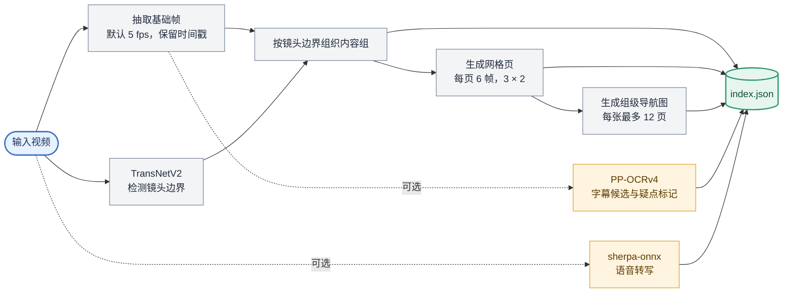

# Video Understanding Kit

**面向 DSH 手机版的网格法视频理解工具包。** 它把视频整理成带时间戳的采样帧、镜头分组、网格图，以及可选的字幕和语音转写，方便 AI 先快速浏览，再按时间回查证据。

> 本项目依赖 DSH 手机版的工具链与目录约定。桌面、服务器和其他 Android 环境尚未验证。使用它的 AI 助手需要支持图像输入。

## 工作流程



网格适合快速浏览和定位；需要确认小字、细节动作或不确定内容时，再打开对应页面或原始帧。分组依据镜头边界，便于整理时间线，不代表完整的语义场景划分。

## 能力一览

- **镜头分组与网格**：抽取带时间戳的基础帧，检测镜头边界，生成网格页和组级导航图。
- **字幕识别（可选）**：PP-OCRv4 提取画面文字，输出带时间的候选文本和疑点标记。
- **语音识别（可选）**：使用 sherpa-onnx 本地识别语音，生成带时间戳的转写候选。
- **证据回查**：通过 `index.json` 中的时间戳、帧 ID 和页面关联，定位网格页或原始帧。
- **DSH 插件（可选）**：`dsh-plugin/` 提供 `video_analyze` 和 `video_frame` 两个工具，详见 [插件说明](dsh-plugin/README.md)。

## 安装

运行环境：DSH 手机版、Node.js 20 或更新版本、ffmpeg、ImageMagick。

在项目目录安装依赖并下载模型：

```bash
pnpm install
node download-models.mjs
```

模型下载脚本获取 TransNetV2 与 PP-OCRv4 模型，约 **47 MB**。OCR 和镜头检测通过 `onnxruntime-web` 运行。

### 可选：语音识别

`--asr` 需要 sherpa-onnx 运行时和中文 Paraformer 模型，模型约 **227 MB**，不包含在上述 47 MB 中。安装方法见 [sherpa-onnx](https://github.com/k2-fsa/sherpa-onnx) 和 `asr.mjs` 顶部说明。未安装时请不要传入 `--asr`；基础分组、网格和字幕功能不受影响。

## 使用

```bash
# 镜头分组与网格
node pipeline.mjs --video video.mp4 --out out

# 同时提取画面字幕
node pipeline.mjs --video video.mp4 --out out --subs

# 同时进行语音识别（需安装 sherpa-onnx 和模型）
node pipeline.mjs --video video.mp4 --out out --asr

# 按需同时启用字幕提取和语音识别
node pipeline.mjs --video video.mp4 --out out --subs --asr

# 启动本地预览服务
node serve-preview.mjs
# 浏览器打开 http://127.0.0.1:3329
```

## 输出文件

```text
out/
├── index.json              # 内容组、网格页、字幕、ASR 和镜头边界索引
├── frames/                 # 带时间戳关联的采样帧
└── grids/
    ├── g01-p01.jpg         # 第 1 组第 1 页（每页 6 帧）
    ├── g01-p02.jpg
    ├── g01-sheet-1.jpg     # 第 1 组导航图（每张最多 12 页）
    └── ...
```

`index.json` 常用字段：

| 字段 | 内容 |
|---|---|
| `groups[]` | 内容组的起止时间、网格页和导航图 |
| `pages[].frames[]` | 每个网格格子的时间戳与源帧 ID |
| `subs[]` | OCR 字幕候选；`review` 用于标记建议核验的条目 |
| `candidates[]` | ASR 转写候选 |
| `cuts[]` | TransNetV2 检测到的镜头边界 |

OCR 与 ASR 的结果都是识别候选，不应直接视为准确字幕或完整语音记录。关键文字、数字和台词请结合原帧或音频核验。

## 参数

| 参数 | 默认值 | 说明 |
|---|---:|---|
| `--video` | — | 输入视频路径 |
| `--out` | — | 输出目录 |
| `--subs` | 关闭 | 提取画面字幕（PP-OCRv4） |
| `--asr` | 关闭 | 识别语音（sherpa-onnx） |
| `--base-fps` | 5 | 基础采样帧率 |
| `--diff-threshold` | 8 | 补帧用的帧差阈值 |
| `--page-scale` | 1.8 | 网格页面缩放比例 |

环境变量：`SUBS_SKIP_TH` 控制字幕跳帧阈值（默认 `3.0`）；`DET_MAX_SIDE` 控制 OCR 检测图像长边上限（默认 `720`）。

## 模型与许可

| 模型 | 来源 | 许可 |
|---|---|---|
| TransNetV2 | [soCzech/TransNetV2](https://github.com/soCzech/TransNetV2)，ONNX 转换版来自 [elya5/transnetv2](https://huggingface.co/elya5/transnetv2) | MIT |
| PP-OCRv4 检测与识别模型 | [PaddleOCR](https://github.com/PaddlePaddle/PaddleOCR)，ONNX 模型由 [RapidOCR](https://github.com/RapidAI/RapidOCR) 提供 | Apache-2.0 |
| PP-OCR 字典 | PaddleOCR | Apache-2.0 |
| sherpa-onnx（可选 ASR） | [k2-fsa/sherpa-onnx](https://github.com/k2-fsa/sherpa-onnx) | Apache-2.0 |

使用前请核对各模型及其权重在目标场景下的许可条款。

## 已知限制

- 采样可能漏掉短动作、短镜头或短字幕；展示全部采样帧不等于覆盖了源视频的每一刻。
- 网格缩放后，小字、小物体和细节动作可能难以辨认；必要时请展开网格页并回查原帧或视频片段。
- 镜头分组是时间组织工具，不保证等同于语义场景；一个长镜头中也可能包含多个关键动作。
- OCR 可能误识艺术字、生僻字或低清文字；高置信度结果也需要核验。
- ASR 可能误识同音词和专名，也不能可靠判断说话人归属。
- 性能观测约为视频时长的 1.5–2.5 倍，来自 CPU/WASM 单线程、中端 Android 设备且 OCR 与 ASR 均启用的测试环境；不同设备和选项下会有差异。

## 给 AI 助手的使用提示

请参阅 [PROMPT.md](PROMPT.md)。核心原则是：先读索引、按网格浏览；遇到不确定内容时回查对应帧或音频，并区分观察结果与推测。
