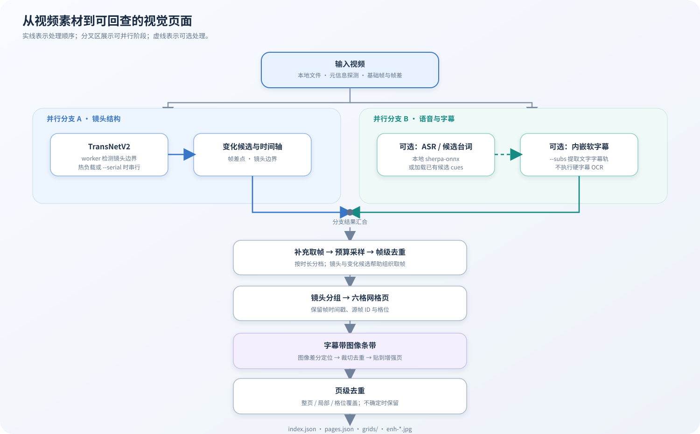

# Video Understanding Kit

把视频整理成可浏览、可回查的视觉材料：带时间戳的采样帧、镜头时间线、六格网格页、字幕图像条带，以及可选的语音转写和软字幕轨提取。

项目由命令行核心流水线和 DSH 插件目录组成。核心负责本地视频处理；它不运行 OCR，也不会自行把硬字幕识别成文本。硬字幕会以图像条带的形式贴到增强页，供后续读图模型查看。决策背景见 [ADR-0019](docs/ADR-0019-remove-ocr.md)。

> 采样、镜头边界和去重都是导航与减量手段，不能证明原视频没有遗漏。关键画面、数字和台词应回看原帧或原音频。

## 工作流程

    输入视频
      └─ 元信息、基础帧与帧差
           ├─ TransNetV2 镜头边界（worker；高负载或串行模式时回到主线程）
           └─ 可选 ASR / 候选台词 + 可选内嵌软字幕
                        ↓ 汇合
    补充取帧 → 预算采样 → 帧级去重 → 镜头分组 → 六格网格页
                                          ├─ 字幕带图像差分定位 → 切条、去重、贴到页底
                                          └─ 页级去重
                        ↓
              index.json、pages.json、网格与增强页

TransNet worker 与主线程上的 ASR/字幕处理可以并行运行；温度过高或指定 --serial 时，镜头检测改为串行。字幕条带由图像差分定位，不依赖 OCR 检测框。条带只保留画面，不会自动产生字幕文本。

## 核心处理

### 采样与时间线

默认基础帧率按视频时长分档：最长 10 秒为 12 fps，11–20 秒为 6 fps，21–30 秒为 4 fps，31–40 秒为 3 fps，41–60 秒为 2 fps，超过 60 秒为 1 fps。可用 --base-fps 指定固定帧率。

默认不限制页数。设置 DSH_FRAME_BUDGET 后，采样器会在预算内选择时间覆盖帧，并在 samplingBudget 中记录是否满足最大间隔要求。预算不足会如实报告。

帧差与 TransNetV2 分别提供变化候选和镜头边界；两者用于组织时间线，不代表语义场景或动作结论。

### 网格和两级去重

每页最多 6 帧（2×3），每格保留时间戳和源帧 ID。组级导航拼图按页分批生成。

去重分两级：

1. **帧级**：运动门控、pHash 与条件性 SSIM，在分组拼页前去掉明显重复帧；FRAME_DEDUP=0 可关闭。
2. **页级**：先比较整页和局部区域，再按格位检查覆盖关系。无法确定时保留页面。

被合并的代表关系和去重统计写入索引。去重只减少重复展示，不代表内容无关。

### 字幕与语音

- **硬字幕**：不运行 OCR。字幕带探测器从视频帧的逐行变化中寻找位置稳定、变化频繁的区域；随后按页裁成图像条带并贴到增强页。条带可能误取画面纹理，也可能漏掉不固定位置的文字。
- **软字幕**：传入 --subs 时提取视频内嵌的文字字幕轨；没有兼容字幕轨时不会转成硬字幕 OCR。
- **语音**：传入 --asr 时使用本地 sherpa-onnx Paraformer 识别音轨，产物写入 audio/。识别文本仍可能漏字或错字。

核心流水线提供供模型阅读的图像和结构化定位信息；硬字幕文本需要读图模型另行读取，不是流水线自动生成的 OCR 结果。

## 命令行

要求 Node.js 20+、pnpm、FFmpeg 和 ImageMagick。

    pnpm install
    pnpm run models
    node pipeline.mjs --video video.mp4 --out out
    node pipeline.mjs --video video.mp4 --out out --subs
    node pipeline.mjs --video video.mp4 --out out --asr
    node pipeline.mjs --video video.mp4 --out out --serial
    node serve-preview.mjs out

| 参数 | 默认值 | 说明 |
|---|---:|---|
| --video | 必填 | 输入视频 |
| --out | out | 输出目录；非空目录需显式传 --force |
| --base-fps | 自动 | 固定基础采样率；省略时按视频时长分档 |
| --subs | 关闭 | 提取兼容的内嵌软字幕轨 |
| --asr | 关闭 | 本地语音识别 |
| --serial | 关闭 | 让 TransNetV2 在主线程串行运行 |
| --force | 关闭 | 覆盖输出目录 |

设置 DSH_FRAME_BUDGET 可启用展示帧预算；DSH_MAX_GAP_SEC 控制期望的最大相邻采样间隔。其他实验性采样参数见 [pipeline.mjs](pipeline.mjs)。

## 输出

    out/
    ├── index.json       # 帧、镜头组、页面、去重、采样预算与耗时
    ├── pages.json       # 页面和字幕条带的结构化定位信息
    ├── base/            # 基础采样帧
    ├── extra/           # 候选区间补取帧
    ├── grids/           # 六格网格和组级导航图
    ├── band-*.jpg       # 字幕区域图像条带
    ├── enh-*.jpg        # 网格与字幕条带合成页
    ├── subs/            # 启用 --subs 后提取的软字幕
    └── audio/           # 启用 --asr 后的音频与识别产物

实际文件以本次运行结果为准；没有对应输入或开关时，subs/、audio/ 等目录可能不存在。

## DSH 插件

插件源码位于 [dsh-plugin/](dsh-plugin/)。当前插件入口公开 video_analyze、video_look、video_report 和 video_frame。它与核心处理流水线的读页入库方案尚未完全接通：video_read_page / video_library 不属于当前入口工具。插件安装和调用细节见 [dsh-plugin/README.md](dsh-plugin/README.md)。

## 架构决策和实测

- [ADR-0018：帧级去重](docs/ADR-0018-frame-level-dedup.md)
- [ADR-0019：删除 OCR，字幕改用图像条带供 VLM 读取](docs/ADR-0019-remove-ocr.md)
- [ADR 与实验索引](docs/README.md)

性能数字来自特定设备和素材的小样本实测，不应直接外推到其他设备或视频类型。

## 开发与同步

根目录的 pipeline.mjs、asr.mjs 和 lib/ 是视频处理核心。插件内的 lib/videokit/ 是随包副本，由同步脚本维护。

    pnpm run sync
    pnpm run check

check 会核对打包文件清单和核心代码副本。模型权重不随仓库分发，使用前请分别核对 [TransNetV2](https://github.com/soCzech/TransNetV2) 与 [sherpa-onnx](https://github.com/k2-fsa/sherpa-onnx) 的许可。
