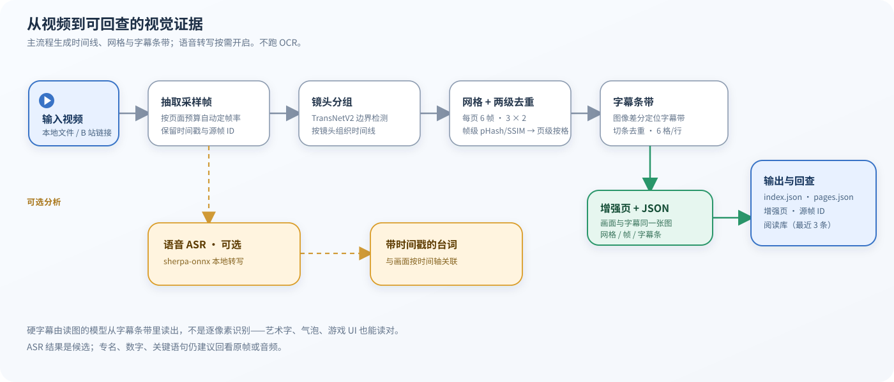

# Video Understanding Kit

**把视频整理成 AI 能高效阅读、又能回查证据的结构**：带时间戳的采样帧、镜头分组、六格网格页、可选的字幕 OCR 与语音转写，外加一层按时间轴把画面和文字串起来的关联表。

项目同时提供命令行流水线和 DSH 插件。

> **识别结果用于定位候选内容，不是结论。** 关键画面、文字和台词仍应回看原帧核验。
> 性能数字都是单机小样本实测，见下方「实测数据」，不要直接外推。

## 它解决的是什么问题

让模型"看视频"有三条常见的坑，这个项目分别对应三个设计：

| 坑 | 对应设计 |
|---|---|
| 逐帧喂图，上下文瞬间爆掉 | **网格页**：六帧拼一张，附源帧 ID 与时间戳 |
| 读完字幕就以为看过画面 | **视觉门禁**：`video_report` 核对实际看过的页数，没看够直接拒收 |
| 大量几乎重复的帧浪费额度 | **视觉去重**：pHash + 局部复核 + 按格覆盖，只留代表页 |

## 工作流程



```text
视频 → 抽帧 → 帧清单（只读，一份）
        ├─ 视觉：帧差 → 分组 → 分页 → 去重
        └─ 文字：OCR → 带时间戳的文字事件
音轨 → ASR → 带时间戳的台词

以上 → 关联层（frames / visualGroups / pages / ocrEvents）→ 输出
```

---

## 方法与技术

### 1. 采样与镜头边界

- **基础帧**：默认 **5 fps**（`--base-fps` 可调 1–12）。这是"呈现帧"，决定网格里能看到什么。
- **帧差候选**：相邻帧直方图差异超过阈值（默认 8）的时间点标为变化点，用于导航。
- **镜头边界**：**TransNetV2**（ONNX，48×27 输入，窗口 100 帧、步长 100）检测真实镜头切换。窗口**不重叠**——实测切换检测结果不变，耗时减半。
- **补帧**：候选区间内按需二次取帧，补细节。

**镜头边界和帧差只用于时间导航，不代表语义场景或动作结论。**

### 2. 网格页

每页固定 **6 帧**（2×3），每格记录 `cell` 坐标、`t` 时间戳、`srcFrameId` 源帧 ID。组级另有 3×N 导航拼图。

**为什么要网格**：一页图的信息密度远高于单帧，模型能一次看到"一段时间内的连续变化"；同时保留源帧 ID，需要细节时可以精确回取原帧。

### 3. 视觉去重（`lib/dedup.mjs`）

三级判据，从粗到细：

1. **整页 pHash**（阈值 6）：全图 DCT 感知哈希，差异超阈值即判"不同"。
2. **2×3 局部复核**（阈值 10）：整图接近但某一块变化明显时，归入 `visualGroup`（同段，不删）。
3. **按格位覆盖**（0.3.0 新增）：把每页的每个格位单独算 pHash，**当前页的每一格都能在代表页找到同格位且差异 ≤ 6**，才判定被覆盖并删除。

**第 3 级解决的具体问题**：网格页是格子的拼贴，整页哈希会把**排版差异**也算进相似度——6 格页和 3 格页（组末尾不足 6 帧）的格内内容完全一样，整页 pHash 却能差 17–27，导致**每组末尾页永远无法去重**。按格比才问得对问题：*这一页的每一格，代表页里有没有一样的？*

**代表页链而非相邻页**：比较对象是"上一个被判定保留的页"，被删的页不更新锚点。否则 A≈B、B≈C 会推出 A≈C，缓慢变化（镜头推近、表情渐变）会被整段吞掉。

**只吃视觉输入**（[ADR-0015](docs/ADR-0015-ocr-visual-decoupling.md)）：去重**不读 OCR 结果**。曾经有"画面相同但字幕不同就保留"的判据，结果是 OCR 开关静默改变了去重结论（同一视频，OCR 开删 2 页、关删 7 页）。字幕变化属于**内容组织**，在关联层表达，不回头改视觉分组。

### 4. 硬字幕 OCR（`subs.mjs` + `lib/ocr-pp.mjs`）

- **引擎**：PP-OCRv4（检测 + 识别分离），**ONNX Runtime Web (WASM)**，`numThreads = 1`。
- **抽帧**：2 fps，宽度缩到 **960**。（640 会让字幕行低于检测器最小尺寸，实测字幕数直接归零——这不是猜测，是踩过的）
- **候选窗口路由**：先 **16 帧稀疏探测**定位有字幕的时间段，只在命中窗口内密集扫描，避免整片盲扫。
- **预算**：默认 **15 秒**（`SUBS_OCR_BUDGET_MS`），超了**如实报"预算耗尽、未覆盖区间未扫描"**，不假装跑完。
- **字幕行判定**：只用**底部居中**的宽扁行——`y0 > 高度×0.6`、水平中心偏移 `< 宽度×0.22`、高度在 2%–16% 之间。这条同时挡掉角落水印和画面主体。
- **画面文字（`screenText`）**：气泡、招牌等非字幕文字单独成列。按**文字状态变化**触发（位置/宽度的聚类键变了才重扫），再按 Levenshtein 相似度去重，不是固定间隔扫描。
- **软字幕优先**：先用 ffprobe 找文字字幕轨（`subrip/ass/ssa/mov_text/webvtt/text`），有就用 ffmpeg 直接抽 SRT，**跳过整个 OCR**——0.2 秒 vs 十几秒。
- **三态**：`subsStatus` ∈ `disabled` / `failed` / `completed`。空数组 + `completed` 才等于「确实没有文字」。**空串不能同时代表「关了」「失败了」「没检出」。**

### 5. 语音 ASR（`asr.mjs`）

- **sherpa-onnx（WASM）** + 中文 Paraformer int8，本地运行，不上传音频。
- 按 **25 秒**切分再识别（`ASR_MAX_SEG`）：Paraformer 整段一次性解码，喂太长会明显跑偏。

**字幕和台词是两条独立结果**：`subsCount` 为 0 不代表视频没声音，ASR 也不能代替画面核验。

### 6. 关联层（0.3.0 新增）

`index.json` 的 `relation` 字段，四张表按时间轴关联：

```text
frames         frameId、timestamp、page、group、cell
visualGroups   groupId、representativeFrameId、memberFrameIds
pages          pageId、groupId、memberFrameIds、时间段 from/to
ocrEvents      eventId、start、end、text、sourceFrameIds、pages
```

三条约束：

1. **去重只减少代表图，不抹掉被合并帧的时间记录** —— `memberFrameIds` 保留全部成员。
2. **同一视觉组可能在不同时间反复出现**，不能拿"最早到最晚"当连续覆盖区间。
3. **一条文字可关联多页，一页可挂多条文字**，也允许文字暂时没有页面承载。

**关联层只生成关系，不回写视觉判定。**

### 7. 并发与温控

- **CPU 拓扑**：Android 上 `os.cpus()` 返回空数组，只能从 `/sys` 读 `cpu_capacity`。这台机器是 1+3+4 三档，**按大核数定并发**，不按总核数。
- **并发上限**：手机 4 路 / 桌面 12 路（`DSH_DET_CAP` 可覆盖）。
- **温度分档降档**：`<38℃` 不限 / `38–40℃` 3 路 / `40–42℃` 2 路 / `≥42℃` 1 路。温度可读时以温度为准，不再回落到频率判断——「频率低」既可能是降频也可能是空闲，区分不了。
- **TransNet 走独立 worker**，不占 OCR 的检测池；`DET_CAP` 只作用于 OCR。

**实测结论**：同为 2 路，起跑 30.3℃ 用 44.7s，35.1℃ 用 84.1s（慢 88%）；而 2 路改 4 路只快 15.5%。**温度是主导变量，35℃ 以上该降档，靠加并发救不回来。**

**视觉与 OCR 重叠默认关闭**（`DSH_SUBS_OVERLAP=1` 可开）：实测重叠 118.0s vs 串行 117.5s，无收益——分组分页的 12s 被藏进 OCR 窗口，代价是两边各慢 5–9s 和 60%。**逻辑独立不等于必须物理并发。**

### 8. 视觉门禁

`video_report` 拒绝"只看一两页就下全片结论"：

- 覆盖率按**代表性页**算，被去重删掉的页**既不进分子也不进分母**（`droppedExcluded` 单列）；
- 默认要求 30%，逐页全看模式下要求 100%；
- 提示词里的页数要求**直接由门禁算术派生**，不另算一套——曾经出现过「提示说全看、验收按 30%」的分裂。

---

## 能力清单

- **镜头时间线**：TransNetV2 边界 + 帧差变化点 + 内容分组
- **网格与回查**：六格网格页、组级导航图、源帧 ID、时间戳
- **视觉去重**：三级判据，输出 `kept` / `visualGroup` / `dropped` 三态与代表页映射
- **硬字幕 OCR**：候选窗口路由、软字幕优先、置信度与复核标记
- **语音 ASR**：本地 sherpa-onnx，带时间戳
- **关联层**：画面与文字按时间轴关联，互不覆盖
- **补充取帧**：按时间点重新提取原帧，支持裁剪缩放
- **DSH 插件**：三个工具 + 侧栏面板（OCR/ASR 开关、抽帧率、逐页全看、并发标定、模型管理）

## 环境要求

- Node.js 20+
- pnpm
- FFmpeg、ImageMagick
- DSH 插件需要可运行 Cordis 插件的 DSH 环境

## 安装模型

```bash
pnpm install
pnpm run models     # 视觉模型约 47 MB，不随仓库分发
```

ASR 另需 sherpa-onnx 运行时和中文 Paraformer int8（约 217 MB），见 [asr.mjs](asr.mjs)。

## 命令行使用

```bash
node pipeline.mjs --video video.mp4 --out out              # 只要分组和网格
node pipeline.mjs --video video.mp4 --out out --subs       # 加硬字幕 OCR
node pipeline.mjs --video video.mp4 --out out --asr        # 加语音识别
node pipeline.mjs --video video.mp4 --out out --serial     # TransNet 强制串行（排查用）

node serve-preview.mjs out                                 # 本地预览 http://127.0.0.1:3329
```

| 参数 | 默认 | 作用 |
|---|---:|---|
| `--video` | 必填 | 输入视频路径 |
| `--out` | `out` | 输出目录（非空时需 `--force`） |
| `--subs` | 关 | 硬字幕 OCR |
| `--asr` | 关 | 语音识别 |
| `--base-fps` | 5 | 基础采样率 |
| `--diff-threshold` | 8 | 帧差候选阈值 |
| `--serial` | 关 | 禁用 TransNet worker 并行 |
| `--force` | 关 | 清空并覆盖输出目录 |

## DSH 插件

插件在 [dsh-plugin/](dsh-plugin/)，注册三个工具：

- **`video_analyze`** — 分析视频，返回时间线、分组、网格路径、字幕/台词、去重统计、各阶段耗时
- **`video_look`** — 看第 N 页网格，**图和该页字幕同一个返回，图在前**；`dropped` 页默认拦下
- **`video_frame`** — 按时间点取原始帧，支持裁剪缩放

**OCR / ASR 开关只能从侧栏面板设置**，工具不接受这两个参数——避免 agent 传参把面板开关架空。

侧栏「视频理解」面板：OCR/ASR 开关、1–12 fps 抽帧率、逐页全看模式、OCR 加速标定、模型下载与删除。

Bilibili 链接（含 `b23.tv` 短链）支持，**暂不支持任意 HTTP 直链**。下载的视频保留 **24 小时、最多 3 条**（新的顶掉旧的）——同一视频重复分析不必重新下载，也避开 B 站限流。

安装步骤、配置项和数据目录见 [插件说明](dsh-plugin/README.md)。

## 输出结构

```text
out/
├── index.json   # 时间线、分组、去重、关联层、耗时
├── base/        # 基础采样帧
├── extra/       # 补充帧
├── grids/       # 网格页与组级导航图
├── subs/        # OCR 中间帧
└── audio/       # ASR 音频
```

`index.json` 主要字段：

| 字段 | 内容 |
|---|---|
| `groups[].pages[].frames[]` | 每格的 `cell` / `t` / `srcFrameId` / `extractionId` |
| `dedup` | `stats` + `kept` / `grouped` / `dropped`（含代表页映射） |
| `relation` | 关联层四张表 |
| `subsStatus` | `disabled` / `failed` / `completed` |
| `timings` | 各阶段耗时 |

## 实测数据

**设备**：vivo V2405A（Android 16，1+3+4 八核）。**素材**：57.4s / 720×1280 / 47 页。**都是单机小样本，不要外推。**

| 对照 | 结果 |
|---|---|
| 4 路 vs 2 路（同基准 253/255ms） | 42.9s vs 50.8s，**4 路快 15.5%**，并行效率 3.07 vs 2.31 |
| 温度影响（同为 2 路） | 30.3℃ 44.7s vs 35.1℃ 84.1s，**慢 88%** |
| 视觉与 OCR 重叠 vs 串行 | 118.0s vs 117.5s，**无收益** |
| 按格去重（表白视频 16 页） | dropped 8 → 9，`g01-p04` 被正确识别为重复 |

实验记录：[并发 A/B](docs/EXPERIMENT-2026-11-10-concurrency-ab.md) · [重叠对照](docs/EXPERIMENT-2026-11-10-overlap.md) · 全部 [ADR 与实验索引](docs/README.md)。

## 边界：不保证什么

- **低帧率采样会错过**很短的动作、镜头或字幕——5 fps 只是折中。
- **帧差峰值可能来自转场或镜头运动**，不能直接当成动作发生时刻。
- **网格适合浏览和定位**，快速动作可能因为关键帧没采到而无法判断。
- **去重的准确率取决于内容形态**：静态画面重复多，去重效果好；连续微表情变化时 pHash 感知不到，可能误删——这类要靠关联层和回看补。
- **OCR 与 ASR 会漏字、错字**，专名、数字、关键语句请回看原帧或音频。
- **桌面端未做系统验证**：WASM 推理、单线程 ORT、温控降档都是为手机调的，桌面上的最优配置不同。

## 开发与同步

根目录的 `pipeline.mjs`、`subs.mjs`、`asr.mjs`、`lib/` 是**真源**；插件内副本由脚本生成，不要直接改副本。

```bash
pnpm run sync        # 更新插件内的处理代码副本
pnpm run check       # 打包清单体检 + 副本一致性校验
```

`check` 做两件事：

1. **打包清单体检**（`scripts/check-pack-files.mjs`）：`dsh-plugin/package.json` 的 `files` 白名单 vs 仓库里真实存在的文件，双向比对。漏掉被静态 import 的模块，装上去就 `ERR_MODULE_NOT_FOUND`——这类问题已经出过两次，所以做成检查而不是靠记性。
2. **副本一致性**：`dsh-plugin/lib/videokit/` 与真源逐字节一致。

## 模型与许可

程序代码采用 MIT 许可。模型各有自己的条款，使用前请分别核对：

- [TransNetV2](https://github.com/soCzech/TransNetV2)
- [PaddleOCR](https://github.com/PaddlePaddle/PaddleOCR)
- [sherpa-onnx](https://github.com/k2-fsa/sherpa-onnx)
