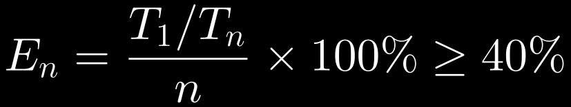
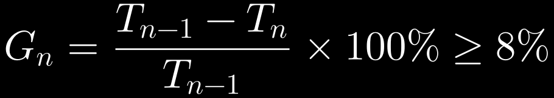

# ADR-0009：并发度标定 —— 当前结果与选择依据

- **状态**：Accepted（仅代表本次标定条件；不是硬件的永久最优配置）
- **影响文件**：`tools/calibrate.mjs`
- **相关**：ADR-0007（OCR 分片并行）、ADR-0008（负载感知）

## 背景

ADR-0007 证明 OCR 检测可以分片并行（1.4~1.6x），ADR-0008 试图用负载档位决定并发数，但**同配置两次测出差 40% 的耗时**（45.3s / 63.4s），靠读频率猜档位不可靠。

所以改成**实测标定**：用固定一小批帧，现场量出这台机器此刻的最优并发数。

## 选择规则

两条阈值同时满足才往上加一档（指挥官提出的规则，2026-11-07 实测确认）：

**并行效率**（相对单路加速里，每一路实际贡献了多少）：



**边际收益**（再加这一档，比上一档快了多少）：



- Tₙ：n 路并发的耗时中位数（同一批输入、同一计时口径、多次测量）
- Eₙ：**并行效率**——相对单路的加速里，每一路实际贡献了多少
- Gₙ：**边际收益**——再加这一档，比上一档快了多少
- 两个都满足才加档；任一条不满足就停在前一档

**为什么不用「距最快档 ≤8%」**：那个规则只看「离最快差多少」，不看「多开这一路换回了什么」。实测里 4 路离最快只差 5%，但边际收益已经是负的——**比 3 路还慢**。只看距离会把它放行。

**判断必须用未舍入的中位数**。曾经出现过「39.51% 显示成 40% 就当成达标」的错误：四舍五入只能用于展示，不能参与阈值判断。

## 本次标定结果（2026-11-06）

**输入**：BV1B1xR6nEi4（26.1s，10 条硬字幕），抽 24 帧（2fps，960 宽，与 OCR 主流程同参数）。
**计时边界**：统计范围就是 `detect` 单个函数调用的墙钟（串行档含逐帧 detect；并行档含 worker 创建到结果回传），不含抽帧、预探测与识别。
**测试顺序**：1 → 2 → 3 → 4 路，每档连续 3 次，档间无额外冷却。
**极差定义**：`(最大值 − 最小值) / 中位数`。

| 并发 | 原始样本（s） | 中位数 | 加速 | 效率 | 极差 |
|---|---|---|---|---|---|
| 1 | 13.90 / 13.30 / 13.23 | 13.30s | 1.00x | 100% | 5% |
| 2 | — / — / — | 11.80s | 1.13x | 56% | 9% |
| 3 | — / — / — | **9.03s** | **1.47x** | 49% | **1%** |
| 4 | — / — / — | 9.91s | 1.34x | 34% | 14% |

（2~4 路的原始样本未单独记录到本文件，见 `tmp/calibrate-result.json` 的 `samples` 字段。）

按新规则逐档判定（数据见上表）：

| 档位 | Eₙ | Gₙ | 判定 |
|---|---|---|---|
| 2 路 | 56% ✓ | 11% ✓ | 通过 |
| 3 路 | 49% ✓ | 23% ✓ | **通过（推荐）** |
| 4 路 | 34% ✗ | -10% ✗ | 拒绝 |

**4 路两条都不满足**：效率掉到 34%（低于 40%），边际为 -10%（比 3 路更慢）。

## 结论

**在本次 24 帧、每档 3 次的标定中，按「效率 ≥40% 且边际 ≥8%」的规则，推荐 3 路；其他任务规模与持续运行条件下的表现待验证。**

后续在 52 帧、TransNet 固定串行的三档实测（1 路 53.3s / 3 路 25.5s / 4 路 26.9s）复验了同一结论：
3 路效率 69.7%、边际 52.2%（通过）；4 路效率 49.5%、边际 -5.5%（拒绝）。

## 边界（这份结论不能推到哪）

- **只代表这次测量条件**。同机同配置在别的时段测出过完全不同的排序（4 路一度最快）。
- **没有定位波动原因**。本次观察到 3 路极差 1%、4 路极差 14%，但这只是 3 个样本的观察，**不能据此推断长期稳定性**，更不能说「4 路忽快忽慢是被争抢导致」。
- **帧数敏感性未验证**。24 帧和 52 帧各测过一次，效率 35.85% / 39.51%（未舍入），数值接近但都没有离散度，**不足以说「帧数影响很小」**。
- **未核对 worker 内部线程数**。如果单实例内部还开多线程，4 路可能是「多层并行互相抢」，这会改变对效率上限的解释（ADR-0007 的「4 核不够独立」也应据此收窄）。
- **40% / 8% 都是产品阈值**，不是物理常数。追求快可以放宽 Eₙ，追求省内存和低温可以提高 Gₙ。两个阈值对 PC 端是否合适**尚未验证**（PC 核数与功耗特性都不同）。

## 复现

```bash
node tools/calibrate.mjs                # 24 帧 × 3 次
node tools/calibrate.mjs --frames 52    # 全量帧
REPS=5 node tools/calibrate.mjs         # 每档测 5 次
COOLDOWN_MS=0 node tools/calibrate.mjs  # 不冷却，模拟连续使用
```

结果落在 `tmp/calibrate-result.json`，含每档原始样本与中位数。
