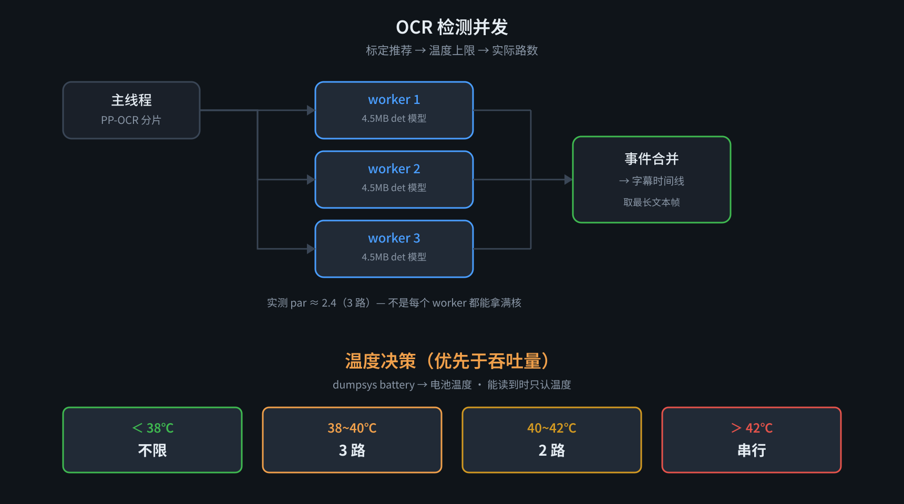

# ADR-0010：温度保护 —— 温度优先于吞吐量

- **状态**：Accepted（2026-11-06）
- **影响文件**：`lib/cpu.mjs`（温度分级）、`subs.mjs`（标定值叠温度上限）、`tools/calibrate.mjs`（测温）
- **相关**：ADR-0008（负载感知）、ADR-0009（并发度标定）



## 背景

理论上 4 路最快。但**连续使用时完全不是这样**：

| 配置 | 轮 1 | 轮 2 | 轮 3 | 温度 |
|---|---|---|---|---|
| 3 路 | **17.25s** | 19.36s | **30.64s** | 37.4 → 39.0℃ |
| 4 路 | 26.93s | 27.41s | 27.98s | 39.7 → **41.5℃** |

**结论**：4 路多占的那个核，先把机器推进降频区——**冷机快 2 倍，热机反而更慢**。

标定测的是**瞬时峰值**（每档之间有冷却），真实使用是**持续负载**。两者不能混为一谈。

## 决策：温度优先，不追求吞吐量

**优先级由指挥官定死**：

```
体验与安全  >  效率
```

温度高时必须降并发，哪怕降了会更慢——**慢比烫坏强**。

## 实现

### 信号来源

| 想要 | 结果 |
|---|---|
| `/sys/class/thermal/thermal_zone*/temp` | **SELinux 挡住，连 `shz` 都读不到** |
| `/proc/stat`、`/proc/loadavg` | EACCES / 空 |
| **`dumpsys battery` 的 temperature** | ✅ **可读**（单位 0.1℃，369 = 36.9℃） |

电池温度比 CPU 核心温度**钝**（滞后），但作为整体发热的代理指标够用——**它不会在你已经烫手时还说凉快**。

### 分级降档

```js
const TEMP_TIERS = [
  { max: 38, n: null, level: 'cool', label: '正常' },
  { max: 40, n: 3,    level: 'warm', label: '偏热' },
  { max: 42, n: 2,    level: 'hot',  label: '过热' },
  { max: Infinity, n: 1, level: 'hot', label: '严重过热' },
]
```

**阈值依据**：3 路在 37~38℃ 是 17~19s，到 39℃ 掉到 30.6s。**拐点就在 38~39℃**，所以第一档设在 38℃。

### 决策链

```
SUBS_DET_WORKERS（显式覆盖）
  ↓ 否则
标定推荐值（ADR-0009，30 分钟 TTL）
  ↓ 再叠
min(标定值, 大核数, 温度上限)
```

**温度上限最后压，压得最狠**——这是刻意的：标定是冷机测的，温度是现在的事实。

## 实测验证

```
36.9℃ → 上限不限 → 4 路（管线实跑：det 26.00s）
38.3℃ → 上限 3 路 → 下次自动降
```

**同一台机器，跑完一轮就升了 1.4℃，保护按预期接管。**

## 边界与未解

- **电池温度不是 CPU 温度**。滞后可能几十秒，极端情况下**降档来得晚**。要更准只能读 thermal_zone，但那被挡住了。
- **没有热惯量建模**。现在是「读到高就降」，没有「预测它还会升多少」。
- **40℃ / 42℃ 两档没有实测校准**——只验证了 38℃ 这一档（因为它先触发）。更高档位是估计值。
- **降档后不会自动升回**。一轮管线内温度降下来也不会加并发（下次调用才重新读）。对一个几十秒的任务来说够用。
- **`dumpsys battery` 依赖 Shizuku**（`shz`）。非 Shizuku 模式下读不到温度，会退回纯频率判断——那时候保护是**弱化**的。
