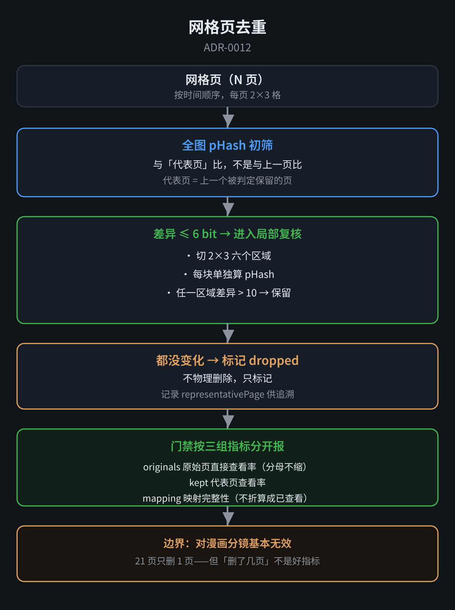

# ADR-0012：网格页去重 —— 全图 pHash 初筛 + 局部区域复核

- **状态**：**Accepted**（2026-11-08）
- **影响文件**：`lib/dedup.mjs`（新增）、`pipeline.mjs`（分页后调用）、`dsh-plugin/index.js`（门禁与 `video_look` 消费）
- **相关**：ADR-0004（网格与补帧）、ADR-0011（视觉强制执行门禁）

## 背景：静止画面会产出大量重复网格页

2026-11-08 实测一个 40 秒、34 页的视频：**前 7 页几乎是同一画面**（慢镜头特写，只有表情和手部微动）。

门禁要求逐页看，**但看的是重复内容**。既费 token，也没有新信息。

## 决策



两阶段判重，**不确定就保留**：

```
全图 pHash 初筛
  → 差异大 → 直接保留
  → 差异小 → 进入局部复核
       → 任一区域有变化 → 保留
       → 都没有变化 → 标记去重
```

### 为什么是 pHash 而不是像素差

**像素差对光照、压缩噪声敏感**，而 pHash 基于 DCT 低频，**对亮度与缩放不敏感**。

**代价**：pHash 对「细微动作」也迟钝——**所以必须有局部复核这一层**。

### 局部复核用固定分区，不用关键点检测

**MediaPipe 那类关键点检测要走 ONNX/TFLite，这台设备上跑不动**（试过）。

**退而求其次**：把画面切成 2×3 六个区域，每块单独算 pHash。

**这是近似**：**如果动作跨在分区边界上，两边都看不到一半。** 实测下来在这个视频上够用（救回 6 页），但**不是终点**。

## 关键修正：串联 → 直接复核

**第一版是串联的**：只跟上一页比。

**问题**（霁璃指出）：

> **A≈B、B≈C，不保证 A≈C。** 缓慢变化（镜头慢慢推近、表情渐变）容易被整段吞掉。

**改为直接复核**：

- **代表页 = 上一个被判定「保留」的页**
- **被去重的页不更新代表页**，后续页继续与同一个代表页比较
- **每个 dropped 记录 `representativePage`**，理由里也写明对比的是哪一页

**实测这个视频恰好同解**（34 → 10），**但机制变了**：p05~p10 现在都直接与 p04 比较，p20 与 p04 的局部差异直接触发保留，**不依赖中间被删的页**。

## 性能：ROI 从 46 秒降到 4.7 秒

**第一版 ROI 每块单独跑一次 `magick` 裁剪 + 解码**：

```
561ms/块 × 6 块/页 × 7 页 ≈ 24s
再加 DCT 计算，总共 46s
```

**改成**：整图一次性取 128×128 灰度，**在 JS 内存里切块**再各缩到 32×32 做 DCT。

**每页 `magick` 调用从 7 次降到 2 次**，12 页 → **4.66s（9.9x）**。

### 为什么是 128 而不是 64

**中间试过 64×64**：降到 4.87s，**但 ROI 太糊**——降采样噪声被当成「局部变化」，保留页从 5 涨到 9（过度保守）。

**128×128 回到 8 页（33.3%）**，接近原分辨率裁剪的判别力。

## 输出形态：只标记，不物理删除

`index.json` 新增 `dedup` 字段：

```json
{
  "stats": { "total": 34, "kept": 10, "dropped": 24, "ratio": 0.706 },
  "kept":    [{ "page": "g01-p01", "reason": "first" }],
  "dropped": [{ "page": "g01-p05", "representativePage": "g01-p04", "reason": "全图 1, 局部最大 6" }]
}
```

**原始 `groups[].pages` 一张不删** —— 门禁、账本、`video_look` 索引都还要用原始页。

**去重结果怎么用，是调用方的事，管线不替它做主。**

## 门禁怎么消费（ADR-0011 的延伸）

**霁璃的批评**：

> **可以少看，但要如实标明少看了什么；不能通过缩小分母，把「暂未发现遗漏」变成「已经看全」。**

**所以门禁按三组指标分开报**：

| 指标 | 含义 | 能否折算 |
|---|---|---|
| `originals` | 原始页直接查看率 | **这是「看全」的口径，分母不缩** |
| `kept` | 代表页查看率 | 首轮阅读成本 |
| `mapping` | 去重映射完整性 | **只说明「可追溯」，不折算成「已查看」** |

`video_look` 默认**拒绝读 dropped 页**，传 `includeDropped: true` 才能展开。

## 边界

**① 对漫画分镜基本无效**

实测 30 秒漫画视频：**21 页 → 20 页（4.8%）**。

**因为**：**同一格画面停留 2-3 秒，每帧都有微小表情变化、头发飘动、气泡位置浮动** → pHash 每次差 5-8 bit → 判「不同」。

**霁璃的纠正**：

> **21 页只去掉 1 页，不足以说明去重失败。** 每页有六格，只要其中一格换了内容，整页就可能不该去重。整张拼图的相似度，也不能准确定位是哪一个时间点发生变化。

**所以「删了几页」不是衡量去重效果的好指标。**

**② 视觉判据不该承担三种职责**

> **不要让「疑似相同」同时承担调度、删页和完整覆盖三种职责。**

**计划补一个 `visual_group` 状态**（疑似同一视觉段）：**只用于排序和预算分配，不能据此删页**。

**③ 大位移/镜头运动的光流判据**

**纯 JS 光流探针已经能跑**（12.5ms/帧），**但 FB 校验对大位移太严**（前 20 帧全被剔），**且判不出「变化重不重要」**。**尚未接进管线。**

## 实测数据（2026-11-08）

| 视频 | 页数 | 保留 | 压缩率 | 耗时 |
|---|---|---|---|---|
| 静止特写（40s） | 34 | 10 | 70.6% | 4.66s |
| 动作类（26s） | 21 | 17 | 19.0% | — |
| 漫画分镜（30s） | 21 | 20 | 4.8% | — |

**压缩率随画面变化幅度浮动，这是符合预期的**——**画面变化大的视频本来重复就少**。
