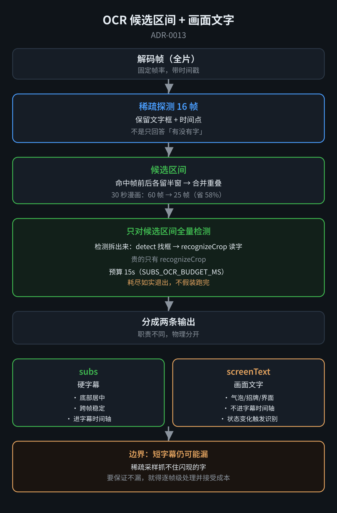

# ADR-0013：OCR 候选区间路由 + 画面文字双路输出

- **状态**：**Accepted**（2026-11-08）
- **影响文件**：`subs.mjs`（预探测、识别循环、返回值）、`pipeline.mjs`（写 `screenText`）、`dsh-plugin/index.js`（`screenTextCount`、`video_look`）
- **相关**：ADR-0011（视觉门禁）、ADR-0012（去重）

## 背景：一条 30 秒视频的 OCR 花了 84 秒

2026-11-08 实测漫画分镜视频（30 秒、21 页）：

```
管线 total  132.6s
字幕提取     84.6s   ← 占 64%
识别结果     3 条
```

**触发规则是「预探测 12 帧，只要有一帧命中字幕行，就全量跑」**——**这个视频每一格都不同，预探测判为「有字」，于是全跑了约 126 帧。**

## 第一次修正：候选区间路由



**把「有没有字」升级成「哪里有字」**：

```
16 帧稀疏采样
  → 命中帧的前后各留半窗（约 2.8s）
  → 合并重叠区间
  → 只在这些区间内全量检测
```

**实测**：**60 帧 → 25 帧（省 58%）**，**字幕提取 84.6s → 49.1s**。

**关键**：

- **没有候选 ≠ 全片无文字**，日志里明确写「画面文字未扫描」
- **pHash 与镜头切分不能单独充当「没有字幕」的判据**
- **预算 15 秒**（`SUBS_OCR_BUDGET_MS`），耗尽如实退出、不假装跑完

## 第二次修正：职责拆开，画面文字单独成路

**那 84 秒只出 3 条，我一开始说「其余全是图画白跑」——这是错的。**

**霁璃纠正**：

> **84.6 秒只产出 3 条，不能证明其余都是白跑。** 可能没文字，也可能有文字但检测／识别失败，或者被过滤、合并掉了。

**真正的原因是 `selectSubtitleLine` 的筛选条件**：

```js
// 只认「底部 + 居中 + 宽扁 + 跨帧稳定」的文字框
b.y0 > fh * 0.6 &&                      // 只在下方 40% 找
Math.abs(cx - fw / 2) < fw * 0.22      // 居中
```

**漫画气泡在角色脑袋旁边、形状不规则、每格位置都在变** → **被判成「不是字幕」扔掉**。

**这不是 bug，是职责边界。**

### 决策：两条路，物理分开

| 输出 | 内容 | 是否进字幕时间轴 |
|---|---|---|
| `subs` | 硬字幕（底部居中、跨帧稳定） | 是 |
| `screenText` | 画面文字（气泡、招牌、界面） | **否** |

**`screenText` 的识别流程**：

```
frames 保留 allBoxes 中不属于字幕行的框（others）
  → 按「文字状态变化」触发识别
  → 结果挂到 merged.screenText
```

**实测**：漫画视频提取出 **8 条旁白**（如「我又凑近了一点」「那天晚上我路过她房间」「我走进房间然后看着她」）。

## 第三次修正：从固定间隔改成状态变化触发

**第一版 `screenText` 是每 2 秒识别一次**，问题：

```
短字幕在 2 秒内闪现 → 漏掉
同一句停留 5 秒 → 重复识别 2-3 次
```

**检测已经全量做过（`others` 就是检测结果），贵的只有 `recognizeCrop`。**

**改成状态变化触发**：

```js
const keyOf = (boxes) => boxes
  .map(b => `${round(x0/40)},${round(y0/20)},${round(宽/40)}`)
  .sort().join('|')

if (key === lastKey && fr.t - lastT < 6) continue   // 状态没变，跳过
```

**同时保留两条兜底**：

- **单帧候选也识别**（不要求连续几帧稳定）
- **同一状态最多隔 6 秒复核一次**（防检测抖动导致长时间不读）

**实测（30 秒漫画视频）**：

```
固定 2 秒：  8 条 / 57.58s
状态变化：   6 条 / 46.24s
```

**去掉的正是两对重复**（9.5s+11.5s、24.5s+26.5s 各合并为一条）。

**这是双赢**：重复识别本身不产生新信息。

## 三条链路的时间

```
原始全量 OCR        84.6s
+ 候选区间           49.1s
+ 画面文字（2秒）     57.6s
+ 画面文字（状态变化） 46.2s
```

**从 84.6 降到 46.2，省 45%。**

## 边界与未解决

**① 短字幕仍可能漏**

**稀疏采样（16 帧）抓不住闪现的字**。**如果要求连一两帧闪过的字都不漏，就不能靠稀疏取样承诺完整性**——需要逐帧级处理并接受成本。

**② OCR 错字**

**「我走进房间然后看着她」→ 识别成「我走送房间然质看着她」**（**形近字误识**）。

**要根治得提高裁剪分辨率或换模型**，是独立方向。

**③ 没有「文字变化时刻」的人工标注**

**目前只有内部一致性验证，缺 ground truth。** 要判断漏检率，需要先人工标一遍。

**④ `screenText` 只认最大的那个框**

**一帧里有多个框时只识别面积最大的一个** —— 可能有遗漏。**先这样，看实测再调。**

## 一句话总结

> **撤销「有字就全扫」，换成「候选区间加密 + 状态变化触发 + 未覆盖明示」；硬字幕模块可以收窄职责，但整条视频理解管线不能借此放弃重要画面文字。**
