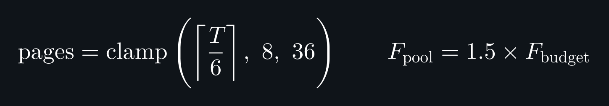
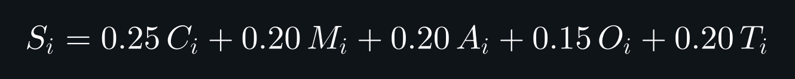
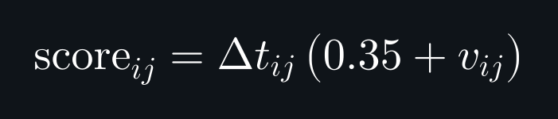

# ADR-0016：采样策略的最终取舍 —— 实测证明「均匀 + 时间保底」最优，加权降级为可选

- **状态**：**Accepted**（2026-11-12），**否决了「变化加权」作为默认**
- **影响文件**：`pipeline.mjs`（`selectCoverageFrames`、动态预算、三种 sampling-mode）
- **相关**：ADR-0003（运动采样）、ADR-0004（网格与补帧）、ADR-0011（视觉门禁）
- **方法论来源**：GPT 提出的「多信号评分 + 动态预算」方案；实测否决了其中的评分层，采纳了预算层

## 背景：页数随时长线性膨胀

2026-11 初的一个 135 秒视频产出 **112 页**网格。门禁要求逐页看，但每页一张图，上下文直接爆掉——**看不完等于没看**。

于是引入两道约束：

1. **代表帧预算**（`FRAME_BUDGET`）：限制进入网格的帧数
2. **保底采样**：预算不够时，按「时间保底 + 镜头保底」裁剪

第一版做完，页数压到 20。**然后我（雪风）继续往里加了一层「画面变化加权」**——认为变化大的片段该给更多帧。

**这一层被实测否决了三次。**

## 决策

**默认采样 = 均匀 + 时间保底；变化加权降级为 `--sampling-mode full` 的可选模式。**

```
默认（uniform）
  按预算帧数在时长上均分取点，页数 = ⌈帧数 / 6⌉

可选（skeleton）
  时间骨架 + 镜头补缺，不做变化加密

可选（full）
  骨架 + 镜头补缺 + 多信号加权加密
```

**动态预算**（决定有多少页可看）：



**页面预算**：在时长 <i>T</i> 下按每页 6 秒推算，并夹在 8–36 页之间；**样本池**取预算帧数的 1.5 倍，否则池子等于预算，"采样"就退化成"全用"。

**五路信号加权**（仅 `full` 模式使用，决定该把帧花在哪）：



**间隙评分**（决定下一个点插在哪）：



其中：

- **<i>T</i>**：视频时长（秒）
- **<i>pages</i>**：网格页数，由第一式算出并夹在 8–36
- **<i>F</i><sub>budget</sub>**：预算帧数，等于 6 × pages
- **<i>F</i><sub>pool</sub>**：样本池帧数，等于 1.5 × F<sub>budget</sub>
- **<i>S</i><sub>i</sub>**：第 i 个候选窗口的信息价值（0–1）
- **<i>C</i><sub>i</sub>**：画面变化（直方图帧差）
- **<i>M</i><sub>i</sub>**：运动强度（块差异）
- **<i>A</i><sub>i</sub>**：音频密度（由字幕密度近似）
- **<i>O</i><sub>i</sub>**：字幕存在性（0 / 1）
- **<i>T</i><sub>i</sub>**：时间结构（是否邻近镜头边界）
- **<i>Δt</i><sub>ij</sub>**：候选间隙长度（秒）
- **<i>v</i><sub>ij</sub>**：该段信号评分（同 S<sub>i</sub>，取段内均值）
- **<i>score</i><sub>ij</sub>**：间隙评分，越大越优先加密

各项信号先按视频自身中位数归一化到 0–3 再截断；第二式的权重 0.25 / 0.20 / 0.20 / 0.15 / 0.20 是起点，未做调参。第三式的 0.35 是下限，避免纯静态段被完全饿死。

**预算语义：上限，不是配额。**

`budgetPages` 是**最多**多少页，不是**必须**凑满多少页。当所有相邻帧的间隙都小于加密下限时，加密就停——**宁可少给几页，也不重复抽帧凑数。**

实测例子：135 秒 / 42 个镜头的视频，预算 20 页，实际产出 13 页（骨架 20 + 镜头补缺 22 + 加密 36 = 78 帧）。每个镜头已经各有一帧，再加密只能把帧挤到 1 秒内，收益为零。

**报告里 `plannedPages` 与 `budgetPages` 不等是正常状态，不是没做完。**

**为什么保留 full 模式**：预算宽裕（每帧 ≤ 1.5 秒）且内容变化剧烈时它不劣于均匀；作为实验/对照模式保留，不作默认。

## 依据：四组同预算对照

### 紧预算（42 帧 / 7 页 / 198 秒视频 / 容差 ±2s）

| 方案 | 帧 | 关键瞬间命中 | 平均偏差 |
|---|---|---|---|
| **均匀** | **42** | **8/8** | **1.16s** ✅ |
| 骨架 + 镜头补缺（不加密） | 35 | 6/8 | 1.96s |
| 单信号 full（变化加权） | 42 | 7/8 | 1.34s |
| 多信号 full（五信号加权） | 42 | 7/8 | 1.34s |

**多信号与单信号的逐瞬间偏差完全相同** —— 评分层在这组预算下**没有产生任何影响**。

### 宽预算（198 帧 / 33 页）

| 方案 | 帧 | 命中 | 平均偏差 |
|---|---|---|---|
| 单信号 · 20 页 | 114 | 8/8 | 0.41s |
| **多信号 · 33 页** | 198 | 8/8 | **0.25s** |
| **均匀 · 33 页** | 198 | 8/8 | **0.34s** |

**宽预算下多信号略好（0.25 vs 0.34），但两者都 8/8 —— 差异只在「离关键时刻更近一点」，不在「有没有看到」。**

## 为什么加权会失败（三层原因）

### ① 单一「画面变化」不是「内容重要性」的好代理

**实测反例**：KV-7 的 164.5 秒处（"豹 2 只有一门炮"）画面静止，但这是全片论点所在。变化加权判定"这里没变化"→ 把帧挪给了 B-roll 素材段 → 该瞬间偏差从 1.5s 恶化到 2.5s，**跌出容差**。

**对「口播 + 素材剪辑」类内容**：
- 变化大的是 **B-roll**（信息载体弱）
- 变化小的是 **讲解画面**（信息载体强）

**加权方向刚好反了。**

### ② 五信号修对了方向，但被「保底机制」挤死

多信号评分（C 画面变化 / M 运动 / A 音频 / O 字幕 / T 镜头结构）确实能让静态讲解段靠 O/A 保住分数——宽预算下平均偏差从 0.34 改善到 0.25 证明了这一点。

**但紧预算下它失效**，原因是**架构**而非评分：

```
42 帧预算
  骨架 10 帧（时间保底）
  + 镜头补缺 25 帧（每个镜头至少一帧）
  = 35 帧，占掉 83%
  → 加密只剩 7 帧
  → 评分只影响 7 个决策，稀释到看不见
```

**保底机制越强，加权能发挥的空间越小。**

### ③ 「均匀」在低密度下本来就接近最优

198 秒 / 42 帧 = **每帧 4.7 秒**。在这个密度下，**只要时间分布均匀，8 个关键瞬间都能落在 ±2 秒内**（实测平均偏差 1.16s）。

**均匀不是"聪明"，是"没有可利用的偏置"** —— 而当所有偏置信号都不够可靠时，**没有偏置就是最好的策略。**

## 后果

**正面**：
- 默认路径简单、可预测、可直接解释给用户（"每 6 秒一页"）
- 页数与时长线性可控，预算公式透明
- 去掉了一个可能引入 case-by-case 调参的复杂度

**负面**：
- 放弃了"把帧花在刀刃上"的可能性——**对高密度、强事件的短视频（动作片、游戏录屏）可能确实有优化空间**，只是本次测试的内容用不上
- `full` 模式保留但未证明优于默认，属于未验证代码

## 未决 / 下一步

1. **微序列（Temporal Micro-sequence）**：一个格子放 5 帧连续动作，解决"单帧无法表达眨眼/挥手"——GPT 方案里最有价值的一条，本次未实现
2. **语义密度代替画面变化**：用字幕关键词、专有名词密度、语速做加权依据——本次未做，是唯一可能翻盘的信号
3. **紧预算下的保底比例**：本次骨架+补缺吃掉 83%，是否该随预算缩放（例如预算 < 90 帧时退化为纯均匀）值得单独测
4. **端侧提速**：1.5fps 让 OCR 耗时从 185s 涨到 600s；RTX 4070 上跑 CUDA 后端预计可压到 30-60s，未验证

## 结论

> **我们花了一整天优化「该把帧花在哪」，最后数据说：先保证「花得均匀」。**
>
> **加权不是错，是过早**——它需要更可靠的"重要性"信号，而目前手上的五个信号都不够好。

---

## 公式图的生成方式

三张公式图（`diagrams/adr16-f1-budget@2x.png` / `f2-signals` / `f3-score`）由 [latex.codecogs.com](https://latex.codecogs.com) 的 PNG 接口生成：`\dpi{300}` 高清、`\color{white}` 白字，再用 ImageMagick 铺 `#0f1419` 深底、加 36px 边距。

**一图一公式**，不要拼在一起 —— 拼图会让三条公式挤成一块，读的时候分不清边界。

**公式交给真正的 LaTeX 引擎渲染**；SVG 手绘只用于流程图这类结构性图示（见 `tools/draw-*-svg.mjs`）。

```bash
# 公式串需 URL 编码；\color{white} 让字形变白，背景由 magick 铺
curl -sL -o k1.png "https://latex.codecogs.com/png.latex?%5Cdpi%7B300%7D%20<urlencode(\color{white} 式①)>"
curl -sL -o k2.png "https://latex.codecogs.com/png.latex?%5Cdpi%7B300%7D%20<urlencode(\color{white} 式②)>"
curl -sL -o k3.png "https://latex.codecogs.com/png.latex?%5Cdpi%7B300%7D%20<urlencode(\color{white} 式③)>"
for i in 1 2 3; do
  magick k$i.png -background '#0f1419' -alpha remove -alpha off \
         -bordercolor '#0f1419' -border 36 adr16-f$i@2x.png
done
```

**两个坑**：

1. `\bg_white` 参数会被当成公式内容渲染出来（图上直接出现 `\bg_white` 字面量）—— 不传背景参数，改由 magick 铺。
2. 拼接要用 `-gravity west`（左对齐）；用默认 `center` 会让三条公式各自居中、左边缘参差。**更好的做法是一图一公式，不拼。**
