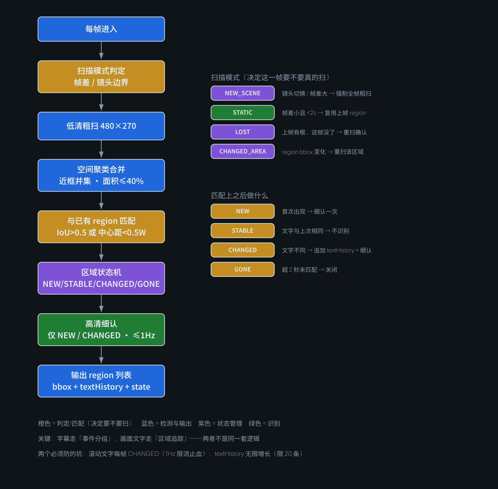

# ADR-0017：画面文字的区域级追踪 —— 低清粗扫 + 空间聚类 + 跨帧状态机

- **状态**：**Proposed**（2026-11-13），待实现
- **影响文件**：`subs.mjs`（新增 region tracker）、`lib/ocr-pp.mjs`（粗扫/细认两级调用）、`pipeline.mjs`（`screenText` 输出结构调整）
- **相关**：ADR-0013（候选窗口）、ADR-0014（字幕带投票）、ADR-0015（OCR 与视觉解耦）

## 背景：ROI 裁剪把画面文字一起裁掉了

为了让字幕检测从 285 秒降到 43 秒，全量检测改成只扫字幕带（占全帧 3.9%）。**代价是画面文字（`screenText`）从 18 条掉到 0 条。**

查了改造前那 18 条到底是什么：

| 内容 | 条数 | 性质 |
|---|---|---|
| `如果` / `V.7坦克` / `成功了` / `今天的坦克` / `会不会都` … | 16 | **字幕碎块**（长字幕被 det 拆成多个框，`others` 筛选没挡住） |
| `6mm`（弹径标注） | 1 | **真·画面文字** |
| `BR-350B`（炮弹型号） | 1 | **真·画面文字** |

**所以 ROI 之后变成 0 条，是「误报清零」而不是「功能坏了」** —— **但真画面文字确实丢了。**

探测帧（16 帧、每 12 秒一帧）虽然做了全帧 det，但覆盖太稀，实测只捞到 1 帧候选、最终 0 条。**周期性全帧检测补不上。**

## 决策



**从「逐帧检测文字框」改成「按区域追踪」**，四个机制配合：

### ① 两级检测：低清粗扫 → 高清细认

| 级别 | 尺寸 | 用途 | 成本 |
|---|---|---|---|
| 粗扫 | 480×270（全帧） | 只回答「哪里可能有文字」 | ~0.18 秒/帧 |
| 细认 | 原分辨率裁剪 | 读准文字内容 | ~0.3 秒/区域 |

**定位不需要清晰度，读字才需要。** 所以粗扫降分辨率、细认只对少量区域做。

### ② 空间聚类：先合并、再细认

**逐框调用 PP-OCR 会产生大量小任务**（每帧十几个框 × 396 帧），调度开销比推理还大。

规则：

```
距离阈值  D = max(20px, 0.03 × 画面宽)      // 960 宽 → 29px
水平/垂直间距都 < D  →  合并
合并后 bbox = 并集 + 8px padding
面积上限 40% 画面  →  超过则停止合并，拆回两块
```

**面积上限是必须的** —— 否则上半部分散布的十个框会合并成一个 960×300 的大块，等于没省。

### ③ 跨帧区域状态机

**位置相同不代表内容相同，内容相同也不代表同一事件。** 所以要维护区域实体：

```js
{
  regionId: 'r001',
  bbox: [700, 30, 900, 100],   // 帧坐标
  firstSeen: 50.0,             // 秒
  lastSeen: 51.0,
  textHistory: ['CPU 85%', 'CPU 86%', 'CPU 87%'],
  state: 'CHANGED'             // NEW / STABLE / CHANGED / GONE
}
```

**匹配规则**（新帧的框 ↔ 已有 region）：

```
IoU > 0.5  或  中心点距离 < 0.5 × 区域宽   →  同一个 region
```

**状态迁移**：

| 情形 | 状态 | 动作 |
|---|---|---|
| 首次匹配 | `NEW` | 高清细认一次 |
| 文字与上次相同 | `STABLE` | **不识别**（省掉重复 rec） |
| 文字不同 | `CHANGED` | 追加 `textHistory`，细认 |
| 连续 3 次相同 | `STABLE` | 降低复检频率 |
| 超过 2 秒未匹配 | `GONE` | 关闭该 region |

### ④ 粗扫复用：不是每帧都要扫

用已有的 `histDiffs` + `cutTimes`（TransNet 镜头边界）判断扫描模式：

| 模式 | 触发条件 | 动作 |
|---|---|---|
| `NEW_SCENE` | 帧在镜头边界附近，或帧差 > 75 分位 | **强制全帧粗扫** |
| `STATIC` | 帧差 < 25 分位，且距上次扫描 < 2 秒 | **复用上一帧 region，跳过扫描** |
| `LOST` | 上一帧有 region、这帧全没了 | **立即重扫确认**（防误判消失） |
| `CHANGED_AREA` | 已有 region 的 bbox 变大/变小/位移 | **重扫** |

## 两个必须防的坑

### 坑 1：滚动文字 / 跳变数字

股票行情、倒计时、滚动字幕 —— **region 每帧都 `CHANGED`，rec 次数暴涨。**

**对策**：每个 region 的 **rec 频率上限 1 Hz**，中间的帧只更新 bbox 和 `lastSeen`，不触发识别。

### 坑 2：textHistory 无限增长

一个 `CPU` 区域跑 5 分钟能攒 300 条。

**对策**：**限长 20 条**，超出时保留「首条 + 每 5 条抽 1 条 + 末 3 条」 —— 能看出变化趋势，又不爆内存。

## 成本预估

| 阶段 | 现状（纯 ROI） | 新方案 |
|---|---|---|
| 字幕带 det | 43 秒 | 43 秒（不变） |
| 画面文字粗扫 | 0 | ~70 秒 |
| 画面文字细认 | 0 | ~10 秒 |
| **小计** | **43 秒** | **~80 秒** |

**多花 37 秒，换取画面文字的全帧覆盖**（而不是 12 秒一帧的稀疏抽样）。

## 开关

```
SUBS_SCREEN_TEXT=1   开启（默认）
SUBS_SCREEN_TEXT=0   关闭，纯字幕模式，回到 43 秒
```

**理由**：不是所有视频都需要画面文字。纯口播开它只是浪费时间；图表/参数/教程类才需要。

## 后果

**正面**
- 画面文字从「稀疏抽样」变成「全帧追踪」，且能记录同一区域的内容随时间变化（`textHistory`）
- 误报（字幕碎块）在聚类阶段被合并或排除，输出质量比改造前更好
- 扫描复用让静态段落几乎零成本

**负面**
- 多 37 秒，且默认开启意味着所有视频都付这个成本（可用开关关掉）
- 区域匹配的阈值（IoU 0.5 / 中心距 0.5 宽）是拍的，未实测调参
- 状态机增加了复杂度，出错时排查成本高于原来的无状态流程

## 未决 / 下一步

1. **阈值全部未调参**：距离阈值、面积上限、IoU、rec 频率上限 —— 需要在 3-5 个不同风格的视频上实测
2. **滚动文字的降级策略**：1 Hz 限流只是止血，是否该对滚动区域直接放弃 tracking、退化成「每 3 秒采样一次」
3. **竖排文字 / 多语言**：PP-OCRv4 中文模型对竖排效果未知
4. **粗扫分辨率的下限**：480×270 是否够定位小字号文字（如参数表里 12px 的字）未验证

## 结论

> **字幕和画面文字是两种不同性质的文字：字幕是「时间轴上的连续文本」，画面文字是「空间上的区域对象」。**
>
> **前者适合事件分组，后者适合区域追踪。** 用同一套逐帧检测逻辑处理两者，就会在降本时把后者一起牺牲掉。
